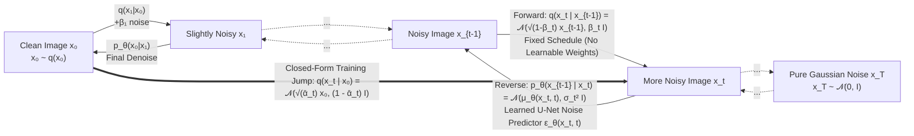
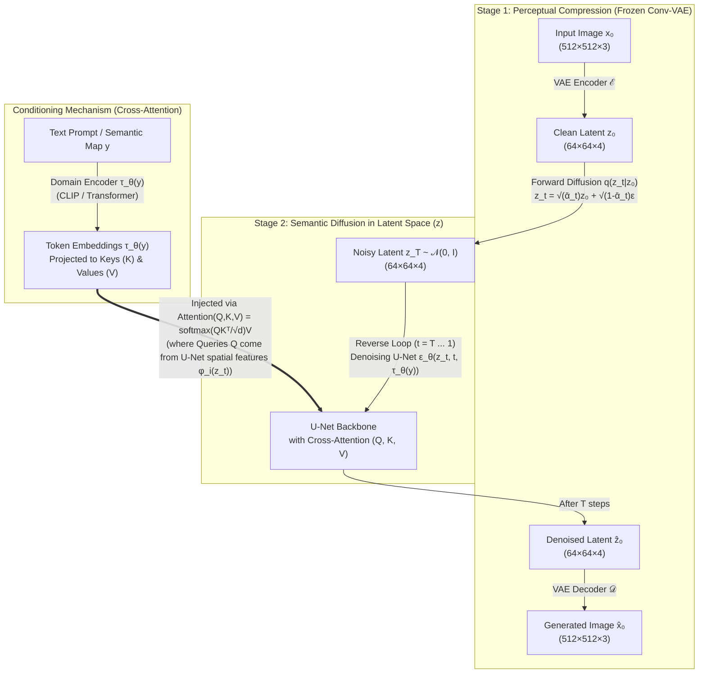

# Diffusion & Latent Diffusion Models: Comprehensive Theory & Seminar Guide (CS420: S06)
**Bridging CS 182 Latent Variable Models (VAEs, Flows, GANs) to DDPM (Ho et al., 2020) & Latent Diffusion (Rombach et al., 2022)**

---

## Table of Contents
1. [Guiding Question & The Connection to CS 182 VAEs](#1-guiding-question--the-connection-to-cs-182-vaes)
   - 1.1 Guiding Question: How Can Learning to Remove Noise Generate New Images?
   - 1.2 Connecting CS 182 VAEs to Diffusion: A Hierarchical Markovian VAE with a Fixed Encoder
2. [Task 1: Generative vs. Discriminative Models & Qualitative Paradigm Comparison](#2-task-1-generative-vs-discriminative-models--qualitative-paradigm-comparison)
   - 2.1 Discriminative vs. Generative Models
   - 2.2 The Generative Learning Trilemma: Comparing Autoregressive, VAEs, Normalizing Flows, GANs, DDPMs, and LDMs
3. [Task 2: The Forward Process, $\beta_t$ Schedule, Closed-Form Jump & Reverse Denoising](#3-task-2-the-forward-process-beta_t-schedule-closed-form-jump--reverse-denoising)
   - 3.1 The Forward Diffusion Process $q(x_t \mid x_{t-1})$
   - 3.2 Why Multiply by $\sqrt{1 - \beta_t}$? (Variance Preservation Proof)
   - 3.3 The $\beta_t$ Variance Schedule (Linear vs. Cosine)
   - 3.4 Closed-Form $t$-Step Jump: $q(x_t \mid x_0) = \mathcal{N}(\sqrt{\bar{\alpha}_t}x_0, (1 - \bar{\alpha}_t)\mathbf{I})$
   - 3.5 The Reverse Process $p_\theta(x_{t-1} \mid x_t)$ & Why Tractable Posterior $q(x_{t-1} \mid x_t, x_0)$ Exists
   - 3.6 Parameterizing the Noise Predictor $\epsilon_\theta(x_t, t)$ & Deriving $L_{\text{simple}}$ from the ELBO
   - 3.7 Training vs. Sampling Algorithms (DDPM Algorithms 1 & 2)
   - 3.8 Deep Dive: Why Reverse Sampling Needs $+\sigma_t z$ (Intuitive & Mathematical Proof of Collapse to the Average Image, and What Happens When a Random Kick Points Toward the "Wrong" Mode)
   - 3.9 Bidirectional Diagrams of Forward Noising & Reverse Denoising
4. [Section III & Task 3: Formal Equation Specifications & Step-by-Step Worked Numerical Example](#4-section-iii--task-3-formal-equation-specifications--step-by-step-worked-numerical-example)
   - 4.1 Equation 1 Specification: $q(x_t \mid x_{t-1}) = \mathcal{N}(\sqrt{1 - \beta_t}x_{t-1}, \beta_t \mathbf{I})$
   - 4.2 Equation 2 Specification: $L_{\text{simple}} = \mathbb{E}_{t, x_0, \epsilon}\big[\|\epsilon - \epsilon_\theta(x_t, t)\|^2\big]$
   - 4.3 Complete Step-by-Step 1D Worked Numerical Example (Forward Step, Stochastic Expectation, Loss & Reverse Step)
5. [Task 5: Latent Diffusion Models (LDM), Perceptual VAE Compression & Cross-Attention](#5-task-5-latent-diffusion-models-ldm-perceptual-vae-compression--cross-attention)
   - 5.1 Why Pixel-Space Diffusion Hits a Computational Wall (Semantic vs. Perceptual Compression)
   - 5.2 Stage 1: Perceptual Compression via a Fully Convolutional Autoencoder ($\mathcal{E}, \mathcal{D}$)
   - 5.3 Stage 2: Diffusion Operations in Latent Space ($z_0 \leftrightarrow z_T$)
   - 5.4 Conditioning Mechanisms: Cross-Attention ($Q, K, V$) & Classifier-Free Guidance (CFG)
   - 5.5 Complete Latent Diffusion Pipeline Diagrams
6. [Task 6: Explicit Comparison (Pixel vs. Latent Diffusion) & Critical Limitations](#6-task-6-explicit-comparison-pixel-vs-latent-diffusion--critical-limitations)
   - 6.1 Evidence-Supported Comparison: Pixel-Space DDPM vs. Latent Diffusion (LDM)
   - 6.2 Downsampling Factor Trade-Off ($f \in \{1, 2, 4, 8, 16, 32\}$)
   - 6.3 Critical Analysis of Limitations: Sampling Speed, Prompt Control, Training Data, Copyright & Bias
7. [Task 4 & Seminar Deliverables Checklist: Experiments to Run](#7-task-4--seminar-deliverables-checklist-experiments-to-run)

---

## 1. Guiding Question & The Connection to CS 182 VAEs

### 1.1 Guiding Question: How Can Learning to Remove Noise Generate New Images?
In generative modeling, our goal is to transform samples from a simple, known prior distribution (standard isotropic Gaussian noise $\mathcal{N}(\mathbf{0}, \mathbf{I})$) into complex, high-dimensional samples from the true data distribution $p_{\text{data}}(x)$.

* **Why 1-Step Generation Struggles:** A Variational Autoencoder (VAE) attempts to map random Gaussian noise $z \sim \mathcal{N}(\mathbf{0}, \mathbf{I})$ to a clean image $x$ in a **single deterministic/Gaussian decoder pass** $p_\theta(x \mid z)$. Because a single Gaussian step cannot easily model sharp, multi-modal transitions in pixel space, the decoder averages over possible outcomes and outputs blurry images.
* **The Diffusion Insight (Iterative Refinement):** Instead of jumping from pure noise to a complex image in one giant leap, **Diffusion Models** break the transformation into $T$ tiny, tractable steps ($T \approx 1000$):
  1. **Forward Noising (Destruction):** Take a real image $x_0 \sim q(x_0)$ and gradually add a tiny amount of Gaussian noise over $T$ steps ($x_0 \to x_1 \to x_2 \to \dots \to x_T$) until the signal is completely destroyed and $x_T$ is indistinguishable from pure standard Gaussian noise $\mathcal{N}(\mathbf{0}, \mathbf{I})$.
  2. **Reverse Denoising (Creation):** Train a neural network $\epsilon_\theta(x_t, t)$ to look at a noisy image $x_t$ at step $t$ and predict the small amount of noise that was added.
  3. **Generating Brand-New Images:** Once the network knows how to nudge *any* noisy image $x_t$ slightly toward the manifold of clean images ($x_{t-1}$), we no longer need a real image $x_0$! At test time, we simply draw pure random static $x_T \sim \mathcal{N}(\mathbf{0}, \mathbf{I})$ and iteratively apply our learned denoiser $T$ times ($x_T \to x_{T-1} \to \dots \to x_0$), gradually sculpting a brand-new, realistic image out of random noise:
     * **Large $t$ ($t \approx T \to 500$):** The denoiser carves out coarse global layout, pose, and low-frequency color blobs from pure static.
     * **Medium $t$ ($t \approx 500 \to 100$):** Object boundaries, semantic structures, and parts emerge.
     * **Small $t$ ($t \approx 100 \to 1$):** Crisp high-frequency textures, edges, and fine details are resolved.

---

### 1.2 Connecting CS 182 VAEs to Diffusion: A Hierarchical Markovian VAE with a Fixed Encoder
If you already understand the **Variational Autoencoder (VAE)** from CS 182 Lecture 17 & 18, you already know 80% of the mathematics of **Denoising Diffusion Probabilistic Models (DDPMs)** ([Ho et al., 2020](file:///D:/AI/Diffusion/2006.11239v2.pdf)).

In fact, **a DDPM is mathematically a Hierarchical Markovian Variational Autoencoder** with three specific structural choices:

| Component | Standard VAE (CS 182 Lecture 18) | Diffusion Model / DDPM (Ho et al., 2020) |
| :--- | :--- | :--- |
| **Observed Data** | Clean image $x \in \mathbb{R}^D$ | Clean image $x_0 \in \mathbb{R}^D$ |
| **Latent Variable(s)** | Single compressed latent vector $z \in \mathbb{R}^d$ ($d \ll D$) | Sequence of $T$ latent states $x_1, x_2, \dots, x_T \in \mathbb{R}^D$, each having the **exact same dimensionality $D$** as $x_0$. |
| **Prior Distribution** | $p(z) = \mathcal{N}(\mathbf{0}, \mathbf{I})$ | $p(x_T) = \mathcal{N}(\mathbf{0}, \mathbf{I})$ at the end of the chain ($t=T$). |
| **Inference / Encoder $q$** | **Learnable** neural network $q_\phi(z \mid x) = \mathcal{N}(\mu_\phi(x), \sigma_\phi^2(x))$ with weights $\phi$. | **Fixed (non-learnable)** linear Gaussian Markov chain $q(x_{1:T} \mid x_0) = \prod_{t=1}^T q(x_t \mid x_{t-1})$ with **zero trainable parameters**! |
| **Generative / Decoder $p_\theta$** | 1-step decoder $p_\theta(x \mid z)$ | $T$-step Markov reverse chain $p_\theta(x_{0:T}) = p(x_T) \prod_{t=1}^T p_\theta(x_{t-1} \mid x_t)$ sharing a single U-Net across all $t$. |
| **Training Objective** | Maximize single-step ELBO:<br>$\mathbb{E}_{q_\phi}[\log p_\theta(x \mid z)] - D_{\text{KL}}(q_\phi(z \mid x) \,\|\, p(z))$ | Maximize $T$-step hierarchical ELBO, which simplifies to matching Gaussian means/noise:<br>$\min_\theta \mathbb{E}_{t, x_0, \epsilon}\big[\|\epsilon - \epsilon_\theta(x_t, t)\|^2\big]$ |
| **Why Reparameterization is Used** | To backpropagate through $z = \mu_\phi(x) + \sigma_\phi(x) \odot \epsilon$ into $\phi$. | To sample $x_t = \sqrt{\bar{\alpha}_t}x_0 + \sqrt{1 - \bar{\alpha}_t}\epsilon$ directly at any step $t$ in closed form. |

---

## 2. Task 1: Generative vs. Discriminative Models & Qualitative Paradigm Comparison

### 2.1 Discriminative vs. Generative Models
1. **Discriminative Models:**
   * **Mathematical Target:** Learn the conditional probability distribution $p_\theta(y \mid x)$ (or a direct decision boundary mapping input features $x$ to labels $y$).
   * **Examples:** Logistic Regression, SVMs, ResNet image classifiers, Vision Transformers (ViT), and the **Discriminator $D_\phi(x)$** inside a GAN.
   * **Key Property:** Discriminative models only care about features that *separate* classes. They do **not** model the structure of $p(x)$ itself and **cannot generate new images** (e.g., knowing that a yellow patch differentiates a school bus from a fire truck does not tell you how to draw a complete school bus).
2. **Generative Models:**
   * **Mathematical Target:** Learn the underlying joint or marginal data distribution $p_\theta(x) \approx p_{\text{data}}(x)$ (or conditional distribution $p_\theta(x \mid y)$ for class-/text-conditioned generation).
   * **Examples:** PixelCNN/GPT (Autoregressive), VAEs, Normalizing Flows, GANs, DDPMs, and Latent Diffusion Models (Stable Diffusion).
   * **Key Property:** Capable of **synthesizing brand-new data samples** $x_{\text{new}} \sim p_\theta(x)$, estimating data density/anomalies (in explicit likelihood models), and learning rich unsupervised representations.

---

### 2.2 The Generative Learning Trilemma: Comparing Autoregressive, VAEs, Normalizing Flows, GANs, DDPMs, and LDMs
In modern generative AI, models face the **Generative Learning Trilemma** (Xiao et al., 2022): it is historically difficult to achieve **(1) High Sample Quality (Sharpness)**, **(2) Fast Sampling Speed**, and **(3) Full Mode Coverage (Diversity)** simultaneously.

| Model Family | Core Mechanism & Density Type | Sample Quality (Sharpness) | Mode Coverage & Training Stability | Sampling / Generation Speed | Key Limitations |
| :--- | :--- | :--- | :--- | :--- | :--- |
| **Autoregressive Models**<br>*(PixelRNN, PixelCNN, ImageGPT)* | **Explicit Exact Likelihood:** Chain rule $p(x) = \prod_{i=1}^n p(x^{(i)} \mid x^{(<i)})$ | **High** (No blurry Gaussian averaging across pixels) | **Full Mode Coverage** & very stable MLE training | **Extremely Slow** ($\mathcal{O}(n)$ sequential forward passes, one per pixel!) | Impractical for high-res images ($512 \times 512 = 262,144$ sequential steps); no global latent vector $z$. |
| **Variational Autoencoders (VAEs)** | **Explicit Approximate Likelihood (ELBO):** Encoder $q_\phi(z\mid x)$ + Decoder $p_\theta(x\mid z)$ | **Low / Blurry** (1-step Gaussian decoder hedges bets across modes under $L_2$ loss) | **Full Mode Coverage** & stable optimization | **Very Fast** ($1$ forward pass through Decoder) | Posterior collapse or prior holes; blurry high-frequency textures. |
| **Normalizing Flows**<br>*(NICE, RealNVP, Glow)* | **Explicit Exact Likelihood:** Invertible bijection $x = f_\theta(z)$ with tractable Jacobian $\det J$ | **Moderate** | **Full Mode Coverage** & exact log-likelihood | **Fast** ($1$ forward pass through $f_\theta$) | Latent space cannot compress dimensionality ($\dim(z) = \dim(x)$); requires huge memory/parameter counts. |
| **Generative Adversarial Networks (GANs)**<br>*(DCGAN, WGAN, StyleGAN)* | **Implicit Density (Likelihood-Free):** Minimax game between Generator $G_\theta(z)$ and Discriminator $D_\phi(x)$ | **Extremely High / Razor Sharp** (Mode-seeking behavior avoids averaging modes) | **Poor Mode Coverage (Mode Collapse)** & unstable adversarial dynamics (vanishing gradients, oscillation) | **Very Fast** ($1$ forward pass through $G_\theta$) | No encoder or likelihood $p_\theta(x)$; drops minority modes of the dataset; hard to tune hyperparameters. |
| **Pixel-Space Diffusion (DDPM)**<br>*(Ho et al., 2020)* | **Explicit Approximate Likelihood (ELBO over $T$ steps):** Iterative denoising in pixel space $x_T \to x_0$ | **State-of-the-Art Sharpness** (Each tiny step is genuinely Gaussian) | **Full Mode Coverage** & stable regression-like MSE training ($L_{\text{simple}}$) | **Slow** ($T \approx 1000$ sequential full-res U-Net passes) | Massive compute/VRAM cost at high resolution because $\dim(x_t) = \dim(x_0)$. |
| **Latent Diffusion (LDM)**<br>*(Rombach et al., 2022 / Stable Diffusion)* | **Hybrid (Conv-VAE + DDPM):** Compress $x_0 \to z_0$ via VAE, then run conditioned diffusion in $z$-space | **State-of-the-Art Sharpness** at high resolution ($512^2$–$1024^2$) | **Full Mode Coverage** & stable training | **Fast / Practical** ($T$ steps run on $48\times$ smaller latent tensor, often reduced to 20–50 steps via DDIM) | Still multi-step (slower than 1-step GAN); bounded by frozen VAE reconstruction ceiling on tiny details. |

---

## 3. Task 2: The Forward Process, $\beta_t$ Schedule, Closed-Form Jump & Reverse Denoising

### 3.1 The Forward Diffusion Process $q(x_t \mid x_{t-1})$
Given a clean data sample $x_0 \sim q(x_0)$, the **forward process** (or *diffusion process*) is a fixed Markov chain that gradually adds Gaussian noise to the data over $T$ timesteps according to a variance schedule $\beta_1, \beta_2, \dots, \beta_T \in (0, 1)$:
$$q(x_{1:T} \mid x_0) := \prod_{t=1}^T q(x_t \mid x_{t-1})$$
where each single-step transition is a Gaussian distribution:
$$q(x_t \mid x_{t-1}) := \mathcal{N}\big(x_t; \, \sqrt{1 - \beta_t}\, x_{t-1}, \, \beta_t \mathbf{I}\big)$$

Using the **Reparameterization Trick** from CS 182, sampling $x_t \sim q(x_t \mid x_{t-1})$ is written as:
$$x_t = \sqrt{1 - \beta_t}\, x_{t-1} + \sqrt{\beta_t}\, \epsilon_t, \qquad \text{where } \epsilon_t \sim \mathcal{N}(\mathbf{0}, \mathbf{I})$$

---

### 3.2 Why Multiply by $\sqrt{1 - \beta_t}$? (Variance Preservation Proof)
A crucial question is: *Why do we attenuate the previous image $x_{t-1}$ by $\sqrt{1 - \beta_t}$ instead of simply adding noise $x_t = x_{t-1} + \sqrt{\beta_t}\epsilon_t$?*

**Proof:** Suppose our initial data $x_0$ is normalized to have zero mean ($\mathbb{E}[x_0] = 0$) and unit variance ($\text{Var}(x_0) = 1$).
* **If we did NOT scale $x_{t-1}$ ($x_t = x_{t-1} + \sqrt{\beta_t}\epsilon_t$):**
  Then after $T$ independent noise additions, the variance would grow to $\text{Var}(x_T) = 1 + \sum_{t=1}^T \beta_t \gg 1$ (a *Variance-Exploding* process).
* **With the scaling factor $\sqrt{1 - \beta_t}$:**
  By induction, assume $\text{Var}(x_{t-1}) = 1$. Since $x_{t-1}$ and $\epsilon_t \sim \mathcal{N}(0, 1)$ are independent:
  $$\begin{aligned}
  \text{Var}(x_t) &= \text{Var}\big(\sqrt{1 - \beta_t}\, x_{t-1} + \sqrt{\beta_t}\, \epsilon_t\big) \\
  &= \left(\sqrt{1 - \beta_t}\right)^2 \text{Var}(x_{t-1}) + \left(\sqrt{\beta_t}\right)^2 \text{Var}(\epsilon_t) \\
  &= (1 - \beta_t)(1) + \beta_t(1) = 1
  \end{aligned}$$
  The coefficients are chosen specifically so that the sum of their squares equals $1$:
  $$\left(\sqrt{1 - \beta_t}\right)^2 + \left(\sqrt{\beta_t}\right)^2 = (1 - \beta_t) + \beta_t = 1$$
  This makes the DDPM forward process **Variance-Preserving (VP)**: the total variance remains constant at $1$ across all $t \in \{1, \dots, T\}$, ensuring that $x_T$ converges cleanly to a standard unit Gaussian $\mathcal{N}(\mathbf{0}, \mathbf{I})$.

---

### 3.3 The $\beta_t$ Variance Schedule: Purpose & Which Schedule to Choose for Which Data

#### 1. The Three Core Purposes of $\beta_t$ Scheduling
The variance schedule $\{\beta_t\}_{t=1}^T$ is not just an arbitrary list of numbers; it performs three mathematical jobs:
1. **Job 1: Keeping the Reverse Step $q(x_{t-1} \mid x_t)$ Gaussian (Feller's Theorem, 1949):**
   * Our reverse model $p_\theta(x_{t-1} \mid x_t) = \mathcal{N}(\mu_\theta, \sigma_t^2\mathbf{I})$ assumes each reverse step is a **single Gaussian**. By Feller's theorem, the reverse of a Gaussian forward step is only Gaussian when the step size $\beta_t \ll 1$.
   * **Why $\beta_1$ must be tiny ($10^{-4}$) while $\beta_T$ can be $200\times$ larger ($0.02$):**
     * **Near $t = 1$ (Sharp Data Manifold):** The clean image distribution $q(x_0)$ is razor-sharp and highly non-Gaussian. Even a moderate noise step would mix multiple distinct images, making the true reverse distribution $q(x_0 \mid x_1)$ multi-modal. Thus $\beta_1$ must be tiny ($\approx 10^{-4}$) so the reverse step is purely local and Gaussian.
     * **Near $t = T$ (Smooth Noise Manifold):** By large $t$, $q(x_t)$ has already been smoothed into a wide bell curve close to $\mathcal{N}(\mathbf{0}, \mathbf{I})$. Because the density is already smooth and Gaussian, we can take much larger steps ($\beta_T \approx 0.02$) without breaking the Gaussian approximation!
2. **Job 2: Guaranteeing Zero Signal Leakage at $t = T$ ($\bar{\alpha}_T \approx 0$):**
   * At inference time, we start from pure standard normal noise $x_T \sim \mathcal{N}(\mathbf{0}, \mathbf{I})$.
   * Therefore, the cumulative product $\bar{\alpha}_T = \prod_{t=1}^T (1 - \beta_t) \approx \exp\big(-\sum_{t=1}^T \beta_t\big)$ **must decay to $\approx 0$** by step $T$.
   * *Rule when changing $T$:* Because $\bar{\alpha}_T \approx \exp(-\sum_{t=1}^T \beta_t)$, if you use fewer total steps (e.g., $T = 300$ instead of $T = 1000$), you **must scale $\beta_{\max}$ up** proportionally (e.g., $\beta_{300} \approx 0.03\text{–}0.05$) so the sum $\sum_{t=1}^T \beta_t$ stays around $\sim 10$ and $\bar{\alpha}_T$ still reaches $\approx 0$!
3. **Job 3: Pacing Frequency Destruction Across Scales (Coarse-to-Fine Hierarchy):**
   * Natural images follow a $1/f^2$ power law: **high-frequency details** (edges, fine textures) have tiny power and are erased by tiny noise at small $t$ ($\beta_t \sim 10^{-4}$), whereas **low-frequency global structures** (overall pose, large color regions) span hundreds of correlated pixels and require huge cumulative noise ($1 - \bar{\alpha}_t \to 1$) to erase.
   * A well-designed schedule spaces out the Signal-to-Noise Ratio $\text{SNR}(t) = \frac{\bar{\alpha}_t}{1 - \bar{\alpha}_t}$ so the U-Net spends roughly equal steps learning fine textures (small $t$), object parts (medium $t$), and global layout (large $t$).

#### 2. Which $\beta_t$ Schedule Should You Choose for Which Data?
Different data resolutions and domains have vastly different **pixel redundancy**, requiring different schedules:

| Schedule Type | Mathematical Formula | Best Data / Domain to Use It On | Why It Fits This Data |
| :--- | :--- | :--- | :--- |
| **1. Linear Schedule**<br>*(Ho et al., 2020)* | $\beta_t = \beta_1 + \frac{t-1}{T-1}(\beta_T - \beta_1)$<br>*(for $T=1000$: $\beta_1 = 10^{-4} \to \beta_T = 0.02$)* | **Medium-Resolution Pixel Images**<br>($64 \times 64$ to $256 \times 256$ RGB images, e.g., CelebA, LSUN) | Standard baseline. However, on small images ($28^2$ or $32^2$), $\bar{\alpha}_t$ drops too fast in the middle, leaving the final 20% of steps ($t \in [800, 1000]$) as wasted pure static. |
| **2. Cosine Schedule**<br>*(Nichol & Dhariwal, 2021)* | $\bar{\alpha}_t = \frac{f(t)}{f(0)}, \; f(t) = \cos^2\!\left(\frac{t/T + s}{1 + s}\frac{\pi}{2}\right)$<br>*(with offset $s = 0.008$, $\beta_t = 1 - \frac{\bar{\alpha}_t}{\bar{\alpha}_{t-1}} \le 0.999$)* | **Low-Resolution Images ($28 \times 28$ MNIST, $32 \times 32$ CIFAR-10)**, **2D Toy Data**, & **Tabular / 3D Point Clouds** | Low-dim / low-res data has very little spatial redundancy, so linear noise destroys the signal too early. Cosine decays $\bar{\alpha}_t$ gently in the middle, spending more steps in the critical mode-splitting zone ($\bar{\alpha}_t \in [0.2, 0.8]$). |
| **3. Scaled-Linear (Quadratic $\beta_t$)**<br>*(Rombach et al., 2022 / Stable Diffusion)* | $\beta_t = \left(\sqrt{\beta_1} + \frac{t-1}{T-1}\big(\sqrt{\beta_T} - \sqrt{\beta_1}\big)\right)^2$<br>*(for $T=1000$: $\beta_1 = 0.00085 \to \beta_T = 0.012$)* | **Latent Diffusion Models (LDMs)**<br>(VAE Latent Tensors $z_0 \in \mathbb{R}^{64 \times 64 \times 4}$) | Because the VAE encoder $\mathcal{E}(x_0)$ has *already removed* spatial pixel redundancy, every latent entry in $z_0$ is dense with semantic information. A lower max $\beta_T = 0.012$ and linear-in-$\sqrt{\beta}$ spacing prevents abrupt semantic destruction. |
| **4. Shifted / High-Noise Schedule**<br>*(Hoogeboom et al., 2023 / SDXL / Flux)* | Shift SNR by resolution ratio $(H/H_{\text{base}})^2$:<br>$\text{SNR}_{\text{high}}(t) = \left(\frac{H_{\text{base}}}{H_{\text{high}}}\right)^2 \text{SNR}_{\text{base}}(t)$<br>*(or Zero-Terminal-SNR where $\bar{\alpha}_T = 0$ exactly)* | **High-Resolution Images ($512 \times 512$, $1024 \times 1024+$)** & **Video Generation** | In a $1024 \times 1024$ image, a single object spans $16 \times 16 = 256\times$ more pixels than in a $64 \times 64$ image! Averaging a $16\times 16$ patch cancels out independent pixel noise by $\frac{1}{\sqrt{256}} = \frac{1}{16}$, so the global shape remains visible even at high noise. High-res images require **stronger noise (smaller $\bar{\alpha}_t$)** to erase global structure! |

---

### 3.4 Closed-Form $t$-Step Jump: $q(x_t \mid x_0) = \mathcal{N}(\sqrt{\bar{\alpha}_t}x_0, (1 - \bar{\alpha}_t)\mathbf{I})$
A remarkable property of the forward process is that **we can sample $x_t$ at any arbitrary timestep $t$ in closed form in $O(1)$ time**, without having to apply $t$ sequential steps!

#### Mathematical Proof by Recursion
Define:
$$\alpha_t := 1 - \beta_t, \qquad \bar{\alpha}_t := \prod_{s=1}^t \alpha_s$$
Unroll the reparameterized forward step $x_t = \sqrt{\alpha_t}x_{t-1} + \sqrt{1 - \alpha_t}\epsilon_t$ for two steps ($t$ and $t-1$), where $\epsilon_t, \epsilon_{t-1} \stackrel{\text{i.i.d.}}{\sim} \mathcal{N}(\mathbf{0}, \mathbf{I})$:
$$\begin{aligned}
x_t &= \sqrt{\alpha_t}\, x_{t-1} + \sqrt{1 - \alpha_t}\, \epsilon_t \\
&= \sqrt{\alpha_t}\big(\sqrt{\alpha_{t-1}}\, x_{t-2} + \sqrt{1 - \alpha_{t-1}}\, \epsilon_{t-1}\big) + \sqrt{1 - \alpha_t}\, \epsilon_t \\
&= \sqrt{\alpha_t \alpha_{t-1}}\, x_{t-2} + \underbrace{\sqrt{\alpha_t(1 - \alpha_{t-1})}\, \epsilon_{t-1} + \sqrt{1 - \alpha_t}\, \epsilon_t}_{\text{Sum of two independent zero-mean Gaussians}}
\end{aligned}$$
Recall from probability theory that the sum of two independent zero-mean Gaussians $\mathcal{N}(0, \sigma_A^2\mathbf{I}) + \mathcal{N}(0, \sigma_B^2\mathbf{I})$ is a single Gaussian $\mathcal{N}(0, (\sigma_A^2 + \sigma_B^2)\mathbf{I})$:
$$\sigma_A^2 + \sigma_B^2 = \alpha_t(1 - \alpha_{t-1}) + (1 - \alpha_t) = \alpha_t - \alpha_t\alpha_{t-1} + 1 - \alpha_t = 1 - \alpha_t\alpha_{t-1}$$
Repeating this induction all the way back to $x_0$ gives:
$$x_t = \sqrt{\bar{\alpha}_t}\, x_0 + \sqrt{1 - \bar{\alpha}_t}\, \epsilon, \qquad \text{where } \epsilon \sim \mathcal{N}(\mathbf{0}, \mathbf{I})$$
Or in distribution notation:
$$\boxed{q(x_t \mid x_0) = \mathcal{N}\big(x_t; \, \sqrt{\bar{\alpha}_t}\, x_0, \, (1 - \bar{\alpha}_t)\mathbf{I}\big)}$$

* **Signal-to-Noise Ratio (SNR) at step $t$:**
  $$\text{SNR}(t) = \frac{\text{Signal Variance}}{\text{Noise Variance}} = \frac{\bar{\alpha}_t}{1 - \bar{\alpha}_t}$$
  As $t$ goes from $0 \to T$, $\bar{\alpha}_t$ decreases monotonically from $1 \to \approx 0$ (for Ho et al.'s schedule, $\bar{\alpha}_{1000} \approx 4 \times 10^{-5}$), so $\text{SNR}(T) \approx 0$ and $q(x_T \mid x_0) \approx \mathcal{N}(\mathbf{0}, \mathbf{I})$.

---

### 3.5 The Reverse Process $p_\theta(x_{t-1} \mid x_t)$ & Why Tractable Posterior $q(x_{t-1} \mid x_t, x_0)$ Exists

#### Why $q(x_{t-1} \mid x_t)$ Alone is Intractable, But $q(x_{t-1} \mid x_t, x_0)$ is Tractable!
To generate images, we want to reverse the chain and sample from $q(x_{t-1} \mid x_t)$.
* **Without knowing $x_0$:** Computing $q(x_{t-1} \mid x_t) = \frac{q(x_t \mid x_{t-1}) q(x_{t-1})}{q(x_t)}$ requires integrating over the unknown data distribution $q(x_0)$ ($q(x_t) = \int q(x_t \mid x_0)q(x_0)dx_0$), which is intractable, for the exact same reason $\log p_\theta(x)$ is intractable in a VAE!
* **Conditioned on $x_0$ (During Training):** If we *also* condition on the clean training image $x_0$, then by Bayes' rule and the Markov property, $q(x_{t-1} \mid x_t, x_0)$ is completely free of $q(x_0)$ and is just a product/ratio of three known Gaussians:
  $$q(x_{t-1} \mid x_t, x_0) = \frac{q(x_t \mid x_{t-1}, x_0)\, q(x_{t-1} \mid x_0)}{q(x_t \mid x_0)} = \frac{q(x_t \mid x_{t-1})\, q(x_{t-1} \mid x_0)}{q(x_t \mid x_0)}$$
  Completing the square in the Gaussian exponents ([Ho et al., 2020, Equations 6 & 7](file:///D:/AI/Diffusion/2006.11239v2.pdf)) shows that this forward posterior is an **exact tractable Gaussian**:
  $$q(x_{t-1} \mid x_t, x_0) = \mathcal{N}\big(x_{t-1}; \, \tilde{\mu}_t(x_t, x_0), \, \tilde{\beta}_t \mathbf{I}\big)$$
  where the exact variance $\tilde{\beta}_t$ and exact posterior mean $\tilde{\mu}_t(x_t, x_0)$ are:
  $$\tilde{\beta}_t := \frac{1 - \bar{\alpha}_{t-1}}{1 - \bar{\alpha}_t}\beta_t, \qquad \tilde{\mu}_t(x_t, x_0) := \frac{\sqrt{\bar{\alpha}_{t-1}}\beta_t}{1 - \bar{\alpha}_t} x_0 + \frac{\sqrt{\alpha_t}(1 - \bar{\alpha}_{t-1})}{1 - \bar{\alpha}_t} x_t$$

#### Substituting $x_0 = \frac{1}{\sqrt{\bar{\alpha}_t}}(x_t - \sqrt{1 - \bar{\alpha}_t}\epsilon)$ into $\tilde{\mu}_t$
Since $x_t = \sqrt{\bar{\alpha}_t}x_0 + \sqrt{1 - \bar{\alpha}_t}\epsilon$, we can solve for $x_0$ in terms of $x_t$ and the noise $\epsilon$:
$$x_0 = \frac{1}{\sqrt{\bar{\alpha}_t}}\big(x_t - \sqrt{1 - \bar{\alpha}_t}\, \epsilon\big)$$
Plugging this expression for $x_0$ into $\tilde{\mu}_t(x_t, x_0)$ and simplifying algebraically yields the famous formula:
$$\boxed{\tilde{\mu}_t(x_t, x_0) = \frac{1}{\sqrt{\alpha_t}} \left( x_t - \frac{\beta_t}{\sqrt{1 - \bar{\alpha}_t}}\, \epsilon \right)}$$

---

### 3.6 Parameterizing the Noise Predictor $\epsilon_\theta(x_t, t)$ & Deriving $L_{\text{simple}}$ from the ELBO
We define our learnable reverse Markov chain starting at $p(x_T) = \mathcal{N}(\mathbf{0}, \mathbf{I})$:
$$p_\theta(x_{0:T}) := p(x_T) \prod_{t=1}^T p_\theta(x_{t-1} \mid x_t), \qquad p_\theta(x_{t-1} \mid x_t) := \mathcal{N}\big(x_{t-1}; \, \mu_\theta(x_t, t), \, \sigma_t^2 \mathbf{I}\big)$$
where $\sigma_t^2$ is fixed to either $\beta_t$ or $\tilde{\beta}_t$.

Just as in CS 182 Lecture 17, applying Jensen's Inequality to $-\log p_\theta(x_0)$ decomposes the Variational Lower Bound ($L_{\text{VLB}}$) into a sum of KL divergences at each timestep $t$:
$$-\log p_\theta(x_0) \le L_{\text{VLB}} = \mathbb{E}_q \Big[ \underbrace{D_{\text{KL}}\big(q(x_T \mid x_0) \,\|\, p(x_T)\big)}_{L_T \text{ (constant, no }\theta\text{)}} + \sum_{t=2}^T \underbrace{D_{\text{KL}}\big(q(x_{t-1} \mid x_t, x_0) \,\|\, p_\theta(x_{t-1} \mid x_t)\big)}_{L_{t-1} \text{ (Gaussian-to-Gaussian KL!)}} \underbrace{- \log p_\theta(x_0 \mid x_1)}_{L_0} \Big]$$

Look at $L_{t-1} = D_{\text{KL}}\big(q(x_{t-1} \mid x_t, x_0) \,\|\, p_\theta(x_{t-1} \mid x_t)\big)$:
* Because **both** $q(x_{t-1} \mid x_t, x_0) = \mathcal{N}(\tilde{\mu}_t, \tilde{\beta}_t \mathbf{I})$ and $p_\theta(x_{t-1} \mid x_t) = \mathcal{N}(\mu_\theta, \sigma_t^2 \mathbf{I})$ are Gaussians with fixed variances, the KL divergence between them is simply the **squared Euclidean distance between their means**:
  $$L_{t-1} = \mathbb{E}_q \left[ \frac{1}{2\sigma_t^2} \big\| \tilde{\mu}_t(x_t, x_0) - \mu_\theta(x_t, t) \big\|^2 \right] + C$$
* Since $\tilde{\mu}_t = \frac{1}{\sqrt{\alpha_t}}\big(x_t - \frac{\beta_t}{\sqrt{1 - \bar{\alpha}_t}}\epsilon\big)$ and the network already receives $x_t$ as input, Ho et al. parameterize $\mu_\theta(x_t, t)$ in the exact same functional form by having a neural network **$\epsilon_\theta(x_t, t)$ predict the noise $\epsilon$**:
  $$\mu_\theta(x_t, t) := \frac{1}{\sqrt{\alpha_t}} \left( x_t - \frac{\beta_t}{\sqrt{1 - \bar{\alpha}_t}}\, \epsilon_\theta(x_t, t) \right)$$
* Substituting $\tilde{\mu}_t$ and $\mu_\theta$ into $L_{t-1}$, the $x_t$ terms cancel out completely:
  $$L_{t-1} - C = \mathbb{E}_{x_0, \epsilon} \left[ \frac{\beta_t^2}{2\sigma_t^2 \alpha_t (1 - \bar{\alpha}_t)} \Big\| \epsilon - \epsilon_\theta\big(\sqrt{\bar{\alpha}_t}x_0 + \sqrt{1 - \bar{\alpha}_t}\epsilon, \, t\big) \Big\|^2 \right]$$
* **Why Ho et al. drop the front weight to get $L_{\text{simple}}$:** The theoretical coefficient $\frac{\beta_t^2}{2\sigma_t^2 \alpha_t (1 - \bar{\alpha}_t)}$ is huge when $t$ is very small (where denoising is trivial) and tiny when $t$ is large (where global structure is formed). Dropping that weight factor downweights easy tiny-noise steps and forces the U-Net to focus on harder, high-noise semantic steps, yielding **dramatically better sample quality (lower FID)**:
  $$\boxed{L_{\text{simple}}(\theta) := \mathbb{E}_{t, x_0, \epsilon} \left[ \Big\| \epsilon - \epsilon_\theta\big(\sqrt{\bar{\alpha}_t}x_0 + \sqrt{1 - \bar{\alpha}_t}\epsilon, \, t\big) \Big\|^2 \right]}$$

---

### 3.7 Training vs. Sampling Algorithms (DDPM Algorithms 1 & 2)

| Algorithm 1: Training (Fast, Parallel over $t$) | Algorithm 2: Sampling / Generation (Sequential $T \to 1$) |
| :--- | :--- |
| **Repeat** until converged:<br>1. Sample clean image $x_0 \sim q(x_0)$<br>2. Sample random step $t \sim \text{Uniform}(\{1, \dots, T\})$<br>3. Sample standard noise $\epsilon \sim \mathcal{N}(\mathbf{0}, \mathbf{I})$<br>4. Create noisy image in 1 jump:<br>$\quad x_t = \sqrt{\bar{\alpha}_t}x_0 + \sqrt{1 - \bar{\alpha}_t}\epsilon$<br>5. Take gradient descent step on:<br>$\quad \nabla_\theta \big\| \epsilon - \epsilon_\theta(x_t, t) \big\|^2$ | 1. Sample pure noise $x_T \sim \mathcal{N}(\mathbf{0}, \mathbf{I})$<br>2. **For** $t = T, T-1, \dots, 1$ **do**:<br>$\quad$ Draw $z \sim \mathcal{N}(\mathbf{0}, \mathbf{I})$ if $t > 1$, else $z = \mathbf{0}$<br>$\quad$ Compute reverse step:<br>$\quad x_{t-1} = \frac{1}{\sqrt{\alpha_t}}\left(x_t - \frac{1-\alpha_t}{\sqrt{1-\bar{\alpha}_t}}\epsilon_\theta(x_t, t)\right) + \sigma_t z$<br>3. **End for**<br>4. **Return** generated clean image $x_0$ |

> **Why do we add fresh noise $\sigma_t z$ during each reverse sampling step ($t > 1$)?**  
> Because $p_\theta(x_{t-1} \mid x_t) = \mathcal{N}(\mu_\theta(x_t, t), \sigma_t^2 \mathbf{I})$ is a *stochastic probability distribution*, not a deterministic point estimate! Below is the complete intuitive and mathematical proof of why omitting $+\sigma_t z$ causes the distribution to collapse to a blurry average image, and what happens when a random kick points toward a different mode.

---

### 3.8 Deep Dive: Why Reverse Sampling Needs $+\sigma_t z$ (Intuitive & Mathematical Proof + Mode Commitment)

Look at the DDPM reverse sampling update from step $t \to t-1$:
$$x_{t-1} = \underbrace{\frac{1}{\sqrt{\alpha_t}} \left( x_t - \frac{\beta_t}{\sqrt{1 - \bar{\alpha}_t}} \epsilon_\theta(x_t, t) \right)}_{\text{Deterministic Mean }\mu_\theta(x_t, t)} + \underbrace{\sigma_t z}_{\text{Stochastic Kick } (z \sim \mathcal{N}(0, I)\text{ for }t>1)}$$

#### 1. Intuitive Explanation: "The Fork in the Road" & MSE Averaging
Imagine a dataset containing only **two sharp images**:
* **Image A ($x_0^{(A)}$):** A bright digit `'1'` tilted to the **left** ($\backslash$).
* **Image B ($x_0^{(B)}$):** A bright digit `'1'` tilted to the **right** ($/$).

When we add large amounts of Gaussian noise ($t \approx T$), both Image A and Image B get completely buried in static and merge into the exact same cloud $\mathcal{N}(0, \mathbf{I})$. Suppose we start at a noisy image $x_t$ near the center of that cloud:
* **What does the U-Net $\epsilon_\theta(x_t, t)$ predict?** Because the U-Net is trained with **Mean Squared Error ($L_2$) loss** ($L_{\text{simple}} = \mathbb{E}[\|\epsilon - \epsilon_\theta(x_t, t)\|^2]$), the optimal $L_2$ prediction under uncertainty is always the **conditional expectation (arithmetic average)** of all possible outcomes (just as proved for VAE Posterior Collapse in [CS 182 Lecture 18, Section 2.11](file:///D:/AI/Diffusion/cs_182_generative_models_study_guide_lectures_17_19.md#L389-L396)).
* Since $x_t$ is equally likely ($50\% / 50\%$) to have come from Image A or Image B, predicting $100\%$ Image A would incur a huge MSE penalty whenever the true image was B. Thus, the deterministic mean $\mu_\theta(x_t, t)$ points straight toward the **$50/50$ superimposed average** of A and B ($\frac{1}{2}x_0^{(A)} + \frac{1}{2}x_0^{(B)}$, a blurry `'X'` blob)!

```text
                    ┌──► Image A (\)   <-- With +σ_t·z: Random kick pushes x_{t-1} into A's basin!
                    │
Noisy x_T ──────────┼──► Blurry Average (X) <-- Without +σ_t·z: μ_θ pulls straight down the middle ridge!
                    │
                    └──► Image B (/)   <-- With +σ_t·z: Or random kick pushes x_{t-1} into B's basin!
```

* **Without $+\sigma_t z$:** The trajectory rides straight down the central symmetry ridge and lands on a washed-out, blurry average image. Furthermore, because averaging smooths out noise, $\mu_\theta(x_t, t)$ has *less variance* than $1 - \bar{\alpha}_{t-1}$, meaning the input to the U-Net at step $t-1$ falls out-of-distribution!
* **With $+\sigma_t z$:** The random kick breaks the symmetry off the central ridge and restores the exact variance $1 - \bar{\alpha}_{t-1}$ that the U-Net at step $t-1$ was trained to expect.

---

#### 2. Three-Step Mathematical Proof of Collapse to the Average Image

##### Proof Step 1: The Optimal $\mu_\theta^*(x_t, t)$ Explicitly Contains the Blurry Average $\mathbb{E}[x_0 \mid x_t]$
Because $L_{\text{simple}}(\theta) = \mathbb{E}_{x_0, \epsilon}\big[\|\epsilon - \epsilon_\theta(x_t, t)\|^2\big]$ is an $L_2$ regression objective, the exact minimum-MSE solution is the conditional expectation:
$$\epsilon_\theta^*(x_t, t) = \mathbb{E}[\epsilon \mid x_t] = \frac{x_t - \sqrt{\bar{\alpha}_t}\, \mathbb{E}[x_0 \mid x_t]}{\sqrt{1 - \bar{\alpha}_t}}$$
where $\mathbb{E}[x_0 \mid x_t] = \int x_0 \, p(x_0 \mid x_t) \, dx_0$ is the **posterior average of all clean images $x_0$ that could have generated $x_t$**.
Substituting $\epsilon_\theta^*(x_t, t)$ into the DDPM reverse mean formula $\mu_\theta(x_t, t) = \frac{1}{\sqrt{\alpha_t}}\big(x_t - \frac{\beta_t}{\sqrt{1-\bar{\alpha}_t}}\epsilon_\theta(x_t, t)\big)$ gives:
$$\boxed{\mu_\theta^*(x_t, t) = \mathbb{E}[x_{t-1} \mid x_t] = \frac{\sqrt{\bar{\alpha}_{t-1}}\beta_t}{1 - \bar{\alpha}_t} \underbrace{\mathbb{E}[x_0 \mid x_t]}_{\text{Blurry Average Image}} + \frac{\sqrt{\alpha_t}(1 - \bar{\alpha}_{t-1})}{1 - \bar{\alpha}_t} x_t}$$
Thus, $\mu_\theta^*(x_t, t)$ literally pulls $x_t$ toward the blurry posterior average $\mathbb{E}[x_0 \mid x_t]$ at every step!

##### Proof Step 2: The Law of Total Variance (Strict Variance Loss at Every Step)
By the **Law of Total Variance**, the true marginal variance of $x_{t-1}$ decomposes into two strictly positive parts:
$$\underbrace{\text{Var}(x_{t-1})}_{\text{True Variance at }t-1} = \underbrace{\text{Var}\big(\mathbb{E}[x_{t-1} \mid x_t]\big)}_{\text{Variance of }\mu_\theta^*(x_t, t)\text{ alone}} + \underbrace{\mathbb{E}\big[\text{Var}(x_{t-1} \mid x_t)\big]}_{\text{Variance supplied by }+\sigma_t z \; (= \sigma_t^2)}$$
If you drop $+\sigma_t z$ and set $x_{t-1}^{\text{no-noise}} = \mu_\theta^*(x_t, t)$, the variance shrinks by $\sigma_t^2$ at **every single step**:
$$\text{Var}\big(x_{t-1}^{\text{no-noise}}\big) = \text{Var}(x_{t-1}) - \sigma_t^2 < \text{Var}(x_{t-1})$$

##### Proof Step 3: Exact Analytical Proof on a Non-Gaussian Bimodal Dataset $x_0 \in \{-1, +1\}$ (How $+\sigma_t z$ Moves Us Away from the Mean $0$!)
Of course, real data $x_0$ does **not** follow $\mathcal{N}(0, 1)$! Suppose our true data distribution $p_{\text{data}}(x_0)$ consists of **two sharp modes** at $x_0 = -1$ (Mode A) and $x_0 = +1$ (Mode B), with **zero real data at the mean $0$**:
$$p_{\text{data}}(x_0) = \frac{1}{2}\delta(x_0 + 1) + \frac{1}{2}\delta(x_0 - 1), \qquad \text{Mean } \mathbb{E}[x_0] = 0$$

1. **Exact Formula for the Posterior Average $\mathbb{E}[x_0 \mid x_t]$:**
   Given a noisy point $x_t$, the forward likelihood of coming from $+1$ vs. $-1$ is $q(x_t \mid x_0 = \pm 1) = \mathcal{N}(x_t; \, \pm\sqrt{\bar{\alpha}_t}, \, 1 - \bar{\alpha}_t)$. By Bayes' rule:
   $$\begin{aligned}
   \mathbb{E}[x_0 \mid x_t] &= (+1)\, p(x_0 = +1 \mid x_t) + (-1)\, p(x_0 = -1 \mid x_t) \\
   &= \frac{\exp\left(-\frac{(x_t - \sqrt{\bar{\alpha}_t})^2}{2(1-\bar{\alpha}_t)}\right) - \exp\left(-\frac{(x_t + \sqrt{\bar{\alpha}_t})^2}{2(1-\bar{\alpha}_t)}\right)}{\exp\left(-\frac{(x_t - \sqrt{\bar{\alpha}_t})^2}{2(1-\bar{\alpha}_t)}\right) + \exp\left(-\frac{(x_t + \sqrt{\bar{\alpha}_t})^2}{2(1-\bar{\alpha}_t)}\right)} = \boxed{\tanh\left(\frac{\sqrt{\bar{\alpha}_t}}{1 - \bar{\alpha}_t}\, x_t\right)}
   \end{aligned}$$
   Substituting $\mathbb{E}[x_0 \mid x_t] = \tanh\left(\frac{\sqrt{\bar{\alpha}_t}}{1 - \bar{\alpha}_t} x_t\right)$ into our Proof Step 1 formula for $\mu_\theta^*(x_t, t)$ gives the **exact deterministic drift** of the diffusion model:
   $$\boxed{\mu_\theta^*(x_t, t) = \underbrace{\frac{\sqrt{\bar{\alpha}_{t-1}}\beta_t}{1 - \bar{\alpha}_t}\, \tanh\left(\frac{\sqrt{\bar{\alpha}_t}}{1 - \bar{\alpha}_t}\, x_t\right)}_{\text{Mode-Splitting Push toward }\pm 1} + \underbrace{\frac{\sqrt{\alpha_t}(1 - \bar{\alpha}_{t-1})}{1 - \bar{\alpha}_t}\, x_t}_{\text{Contraction Pull toward }0}}$$

2. **Why Omitting $+\sigma_t z$ Traps or Pulls $x_t$ Into the Mean $0$:**
   * **At the mean $x_t = 0$:** $\tanh(0) = 0 \implies \mu_\theta^*(0, t) = 0$. Without $+\sigma_t z$, $x_t = 0$ is a **fixed point**; it stays stuck at the nonexistent average image $x_0 = 0$ forever!
   * **During all early high-noise steps ($t \approx T \to T/2$, where $\bar{\alpha}_t \approx 0$):** Because $\bar{\alpha}_t \ll 1$, the mode-splitting $\tanh$ term is nearly zero ($\frac{\sqrt{\bar{\alpha}_t}\beta_t}{1-\bar{\alpha}_t} \approx 0$), while the second term equals $\approx \sqrt{\alpha_t}\, x_t$ (with $\sqrt{\alpha_t} < 1$).
   * That means **during the first half of reverse sampling, the deterministic mean $\mu_\theta^*(x_t, t) \approx \sqrt{\alpha_t}\, x_t$ actively contracts every point INWARD toward the mean $0$!** If you do not add $+\sigma_t z$, every sample gets shrunk by $\prod \sqrt{\alpha_t}$ right toward $x_t \approx 0$ *before* $\bar{\alpha}_t$ ever becomes large enough for the $\tanh$ term to turn on!

3. **Step-by-Step: How $+\sigma_t z$ Moves Us AWAY from the Mean $0$ and Triggers the Split to $-1$ or $+1$:**
   * **Role 1: Breaking the $x_t = 0$ Deadlock:** Suppose $x_t = 0$ (dead center on the blurry average, where $\mu_\theta^*(0, t) = 0$). Adding $+\sigma_t z$ (say, $+0.25$) physically moves $x_{t-1}$ **away from the mean $0$** to $x_{t-1} = +0.25$.
   * **Role 2: Amplifying via Positive Feedback on the Next Step:** Now that $x_{t-1} = +0.25 > 0$, on step $t-1$ the $\tanh$ term wakes up:
     $$\mathbb{E}[x_0 \mid x_{t-1} = +0.25] = \tanh\left(\frac{\sqrt{\bar{\alpha}_{t-1}}}{1 - \bar{\alpha}_{t-1}} \times 0.25\right) > 0$$
     Because $x_{t-1} > 0$, the posterior average $\mathbb{E}[x_0 \mid x_{t-1}]$ is now biased toward Mode B ($+1$). This causes $\mu_\theta^*(x_{t-1}, t-1)$ to push $x_{t-2}$ even *further* toward $+1$ (say $+0.55$), which makes $\tanh(\cdot)$ even closer to $+1.0$ on the step after that, rapidly locking into the sharp mode $x_0 = +1$!
   * **Role 3: Keeping $x_t$ Away from $0$ Until the Vector Field Itself Flips Direction:** In the early steps ($t \approx T$) when $\mu_\theta^*(x_t, t) \approx \sqrt{\alpha_t}\,x_t$ is trying to shrink $x_t \to 0$, the random kicks $+\sigma_t z$ replenish the variance $(\sqrt{\alpha_t})^2(1) + \beta_t = 1$ so that $x_t$ stays at distance $\sim \mathcal{O}(1)$ away from $0$ until $\bar{\alpha}_t$ grows large enough for $\tanh\left(\frac{\sqrt{\bar{\alpha}_t}}{1-\bar{\alpha}_t}x_t\right) \to \pm 1$ to snap the trajectory into one of the true modes!

#### 4. Why Doesn't the $L_2$-Trained Vector Field at $x_{t-1}$ Always Point Toward the Global Mean Image?
A very subtle question is: *"Since we train with $L_2$ loss across the entire dataset, shouldn't the learned vector field at ANY position $x_{t-1}$ always point toward the global mean image $\mathbb{E}[x_0] = 0$?"*

**No!** Because the U-Net takes $(x_t, t)$ as input, $L_2$ loss does **not** average over all training images equally; it only averages over the training images whose forward noise cloud $q(x_t \mid x_0^{(i)}) = \mathcal{N}(\sqrt{\bar{\alpha}_t}x_0^{(i)}, (1 - \bar{\alpha}_t)\mathbf{I})$ **actually reaches the coordinate $x_t$ at timestep $t$**:
$$\mathbb{E}[x_0 \mid x_t] = \sum_{i=1}^N w_i(x_t, t)\, x_0^{(i)}, \qquad \text{where } w_i(x_t, t) = \frac{\exp\left(-\frac{\|x_t - \sqrt{\bar{\alpha}_t}x_0^{(i)}\|^2}{2(1 - \bar{\alpha}_t)}\right)}{\sum_{j=1}^N \exp\left(-\frac{\|x_t - \sqrt{\bar{\alpha}_t}x_0^{(j)}\|^2}{2(1 - \bar{\alpha}_t)}\right)}$$

Look at how the vector field $\mu_\theta^*(x_t, t) - x_t$ changes completely across $t$:
```text
1. At Large t (t = 1000, Huge Noise: 1 - ᾱ_t ≈ 1):
   The Gaussian clouds of Mode A (-1) and Mode B (+1) completely overlap!
   Every coordinate x_t is hit 50% by A and 50% by B during training (w_A ≈ 0.5, w_B ≈ 0.5).
   Therefore, at t = 1000, the vector field everywhere DOES point INWARD toward the Global Mean 0:
   ────► ────► ────► [ 0 (Global Mean) ] ◄──── ◄──── ◄────
        (-1)                                  (+1)

2. At Medium t (t = 300, Moderate Noise: Clouds Around A=-1 and B=+1 Separate!):
   During training at t = 300, points at x_t = +0.5 are hit ~85% by B (+1) and only ~15% by A (-1)!
   ONLY the dead-center point x_t = 0 still sees 50% A and 50% B!
   Now the vector field at x_t > 0 points OUTWARD (away from 0 and toward +1):
   ────► [ -1 (Mode A) ] ◄──── ◄── [ 0 ] ──► ────► [ +1 (Mode B) ] ◄────

3. At Small t (t = 50, Small Noise: 1 - ᾱ_t ≈ 0.01, Zero Overlap!):
   During training at t = 50, Mode A (-1) NEVER reaches x_t = +0.5 (it is 15 standard deviations away: w_A ≈ 10⁻⁵⁰ ≈ 0, w_B ≈ 1.0)!
   The U-Net at (x_t = +0.5, t = 50) ONLY ever saw training samples from Mode B (+1)!
   So the L2 vector field at x_t > 0 points 100% toward Mode B (+1), with ZERO pull toward 0:
   ════► [ -1 (Mode A) ] ◄═══════  [ 0 ]  ═══════► [ +1 (Mode B) ] ◄════
```
**Summary of the Synergy:**
* At **large $t$**, the vector field *does* pull toward the global mean $0$. The noise $+\sigma_t z$ fights this inward pull and keeps scattering $x_t$ away from $0$.
* Then, as **$t$ decreases**, the training clouds around Mode A and Mode B shrink and separate. Because $+\sigma_t z$ kept our sample away from $0$ (say at $x_t = +0.5$), our sample now sits in a region where Mode A never visits during training, so the $L_2$ vector field at $x_t = +0.5$ **flips direction** and pulls **away from $0$ and straight into Mode B ($+1$)**!

---

#### 3. What If We Want to Sample Mode A, But the Random Kick $+\sigma_t z$ Pushes Toward Mode B?
This question has **two distinct answers** depending on whether we are doing **Unconditional Generation** ($p_\theta(x_0)$) or **Conditional Generation** ($p_\theta(x_0 \mid y = A)$), and **which timestep $t$** we are at:

| Scenario | What Happens When $z$ Points Toward B? | Why It Works Mathematically |
| :--- | :--- | :--- |
| **1. Unconditional Sampling at Early Steps ($t \approx T \to 600$)**<br>*(No prompt given; $x_t$ is still pure ambiguous static)* | **The sample simply becomes Image B!** | In *unconditional* generation, you haven't asked the model for A or B; you only asked for a valid random sample from $p_{\text{data}}(x)$. On 50% of runs, early $z$ kicks push into A's basin (generating a sharp A); on the other 50% of runs, early $z$ kicks push into B's basin (generating a sharp B). That is *how* unconditional diffusion achieves full mode diversity! |
| **2. Unconditional Sampling at Middle/Late Steps ($t \approx 400 \to 1$)**<br>*(Sample has already entered A's basin, e.g., a half-formed dog, and a random kick $z$ points toward B)* | **It stays Mode A! The deterministic drift $\mu_\theta$ immediately pulls it back to A.** | **Two reasons a late kick cannot flip A into B:**<br>1. **Exponential Bayesian Lock-In:** Once $x_t$ is slightly closer to A than B, the posterior probability $p(x_0 = A \mid x_t)$ jumps to $\approx 99.99\%$ while $p(x_0 = B \mid x_t) \approx 0.01\%$ (because Gaussian likelihood $\exp(-\|x_t - \sqrt{\bar{\alpha}_t}x_0\|^2 / 2(1-\bar{\alpha}_t))$ decays exponentially with distance as $1-\bar{\alpha}_t \to 0$). Thus $\mathbb{E}[x_0 \mid x_t] \approx 1.0 \cdot A + 0.0 \cdot B = A$, so the deterministic vector $\mu_\theta(x_t, t)$ acts like a steep gravity well pulling straight back to A!<br>2. **Shrinking Noise Schedule ($\sigma_t \to 0$):** As $t \to 1$, $\sigma_t \approx \sqrt{\beta_t}$ shrinks from $0.141$ (at $t=1000$) down to $0.01$ (at $t=1$). Late kicks are **too tiny** to jump over the high-energy barrier between Mode A and Mode B; they only randomize **fine local textures within Mode A** (e.g., individual fur strands or stroke micro-variations). |
| **3. Conditional Sampling ($p_\theta(x_0 \mid y = \text{"A"})$)**<br>*(You explicitly want Mode A via class label or text prompt $y = A$)* | **Mode B is completely erased from the U-Net's drift from Step $t = T$!** | When you explicitly want A, you pass $y = A$ into the conditioned U-Net $\epsilon_\theta(x_t, t, y=A)$ (and amplify it with Classifier-Free Guidance $w > 1$). Now the U-Net predicts $\mathbb{E}[x_0 \mid x_t, \, \mathbf{y = A}]$, which averages **only over images in Class A**! Even if a random kick $z$ at $t=T$ pushes toward B's coordinates, the guided drift $\mu_\theta(x_t, t, y=A)$ points strongly toward A and overpowers the kick, dragging the trajectory into A's basin. *(Inside Class A, $+\sigma_t z$ still breaks symmetry between sub-modes $A_1, A_2, \dots$ so you get a sharp specific instance of A rather than the blurry average of all A's!)* |

---

### 3.9 Bidirectional Diagrams of Forward Noising & Reverse Denoising

#### Diagram 1: Bidirectional Markov Chain (Required for Task 2)


#### Diagram 2: ASCII Signal Flow for Slides / Quick Reference
```text
FORWARD PROCESS q(x_t | x_{t-1}): Fixed Gaussian Noising (Left to Right):
  ┌──────────┐   q(x_1|x_0)   ┌──────────┐         ┌──────────┐  q(x_t|x_{t-1}) ┌──────────┐         ┌──────────┐
  │ Clean x₀ │ ─────────────► │ Noisy x₁ │ ──...─► │ x_{t-1}  │ ──────────────► │   x_t    │ ──...─► │ Pure x_T │
  │  (Data)  │ ◄───────────── │          │ ◄─...── │          │ ◄────────────── │          │ ◄─...── │ ~ N(0,I) │
  └──────────┘  p_θ(x_0|x_1)  └──────────┘         └──────────┘ p_θ(x_{t-1}|x_t)└──────────┘         └──────────┘
REVERSE PROCESS p_θ(x_{t-1} | x_t): Learned U-Net Denoising (Right to Left, Driven by ε_θ(x_t, t))
```

---

## 4. Section III & Task 3: Formal Equation Specifications & Step-by-Step Worked Numerical Example

Section III of `S06_Seminar_DIFF.pdf` states:
> *"Student need to define every symbol, specify appropriate units/value ranges and modeling assumptions, and provide a complete step-by-step worked example."*

Below is the exact specification table for both required equations.

### 4.1 Equation 1 Specification: $q(x_t \mid x_{t-1}) = \mathcal{N}\big(\sqrt{1 - \beta_t}x_{t-1}, \, \beta_t \mathbf{I}\big)$

| Symbol | Mathematical Definition | Units & Value Range | Modeling Assumptions |
| :--- | :--- | :--- | :--- |
| $t$ | Discrete diffusion timestep index | Unitless integer: $t \in \{1, 2, \dots, T\}$ (typically $T = 1000$) | Discrete-time Markov process over a finite horizon $T$. |
| $x_0$ | Initial clean data sample (image tensor flattened or in 3D grid) | Normalized dimensionless pixel intensity: $x_0 \in [-1, 1]^D$ (linearly scaled from 8-bit $[0, 255]$ integers via $x_0 = \frac{\text{pixel}}{127.5} - 1$) | Continuous state space; normalized so data mean $\approx 0$ and variance $\approx 1$ to match standard normal prior at $t=T$. |
| $x_{t-1}, \, x_t$ | Noisy latent state tensors at timesteps $t-1$ and $t$ | Continuous real vectors/tensors: $x_{t-1}, x_t \in \mathbb{R}^D$ where $D = H \times W \times C$ | **Dimension-preserving latent space:** Every latent $x_t$ has the exact same dimensionality $D$ as the clean image $x_0$. |
| $q(x_t \mid x_{t-1})$ | Forward Markov transition probability density | Probability density: $q \in (0, \infty)$ integrating to $\int q(x_t \mid x_{t-1}) dx_t = 1$ | **Markov Property:** $q(x_t \mid x_{0:t-1}) = q(x_t \mid x_{t-1})$ (future state depends only on the immediately preceding state). |
| $\mathcal{N}(\mu, \Sigma)$ | Multivariate Gaussian (Normal) distribution with mean vector $\mu$ and covariance matrix $\Sigma$ | Mean $\mu \in \mathbb{R}^D$, Covariance $\Sigma \in \mathbb{R}^{D \times D}$ (symmetric positive-definite) | Stepwise perturbations are strictly Gaussian and additive after scaling. |
| $\beta_t$ | Forward diffusion variance schedule at step $t$ | Unitless variance fraction: $\beta_t \in (0, 1)$, typically $10^{-4} \le \beta_t \le 0.02$ with $\beta_1 < \beta_2 < \dots < \beta_T$ | **Fixed (non-learnable) hyperparameter schedule** chosen small enough ($\beta_t \ll 1$) that the reverse transition $q(x_{t-1}\mid x_t)$ is also approximately Gaussian. |
| $\sqrt{1 - \beta_t}$ | Autoregressive signal attenuation (contraction) coefficient | Unitless scalar factor: $\sqrt{1 - \beta_t} \in (0, 1)$ (e.g., $\approx 0.99995$ at $t=1$ and $\approx 0.9899$ at $t=1000$) | **Variance-Preserving (VP) scaling:** $(\sqrt{1-\beta_t})^2 + (\sqrt{\beta_t})^2 = 1$, keeping total variance constant at $1$. |
| $\mathbf{I}$ | $D \times D$ Identity matrix ($\text{diag}(1, 1, \dots, 1)$) | Dimensionless matrix $\mathbf{I} \in \{0, 1\}^{D \times D}$ | **Isotropic Gaussian noise assumption:** Noise added at each step is independent and identically distributed (i.i.d.) across all spatial pixels and RGB channels. |

---

### 4.2 Equation 2 Specification: $L_{\text{simple}} = \mathbb{E}_{t, x_0, \epsilon}\big[\|\epsilon - \epsilon_\theta(x_t, t)\|^2\big]$

| Symbol | Mathematical Definition | Units & Value Range | Modeling Assumptions |
| :--- | :--- | :--- | :--- |
| $L_{\text{simple}}$ | Simplified unweighted noise-prediction training objective (loss) | Non-negative real scalar: $L_{\text{simple}} \in [0, \infty)$ (dimensionless MSE) | Drops the theoretical ELBO weighting factor $\frac{\beta_t^2}{2\sigma_t^2\alpha_t(1-\bar{\alpha}_t)}$ to prioritize semantic high-noise steps ($t \gg 1$). |
| $\mathbb{E}_{t, x_0, \epsilon}[\cdot]$ | Joint mathematical expectation over random variables $(t, x_0, \epsilon)$ | Approximated via empirical mini-batch average of size $B$: $\frac{1}{B}\sum_{i=1}^B [\cdot]$ | Assumes $(t, x_0, \epsilon)$ are sampled independently: $t \sim \mathcal{U}(\{1, \dots, T\})$, $x_0 \sim q(x_0)$, and $\epsilon \sim \mathcal{N}(\mathbf{0}, \mathbf{I})$. |
| $\epsilon$ | Ground-truth standard Gaussian noise realization injected to form $x_t$ | Continuous real tensor: $\epsilon \in \mathbb{R}^D$, drawn from $\mathcal{N}(\mathbf{0}, \mathbf{I})$ (mean $0$, variance $1$, ~99.7% of values in $[-3, +3]$) | Zero-mean, unit-variance i.i.d. Gaussian noise independent of $x_0$ and $t$. |
| $x_t$ | Noisy input image at step $t$ fed into the neural network | Continuous real tensor: $x_t = \sqrt{\bar{\alpha}_t}x_0 + \sqrt{1 - \bar{\alpha}_t}\epsilon \in \mathbb{R}^D$ | Computed via the closed-form $t$-step Gaussian marginal $q(x_t \mid x_0)$. |
| $\theta$ | Learnable parameters (weights & biases) of the denoising neural network | Real parameter vector $\theta \in \mathbb{R}^P$ (e.g., $P \approx 35\text{M}–860\text{M}$ parameters in a U-Net) | **Parameter sharing across time:** A single network $\theta$ handles all $T$ timesteps by conditioning on sinusoidal embeddings of $t$. |
| $\epsilon_\theta(x_t, t)$ | Neural network output predicting the noise component $\epsilon$ inside $x_t$ | Continuous real tensor: $\epsilon_\theta(x_t, t) \in \mathbb{R}^D$ (same shape as $x_t$ and $\epsilon$) | Parameterizes the reverse Gaussian mean via $\mu_\theta(x_t, t) = \frac{1}{\sqrt{\alpha_t}}(x_t - \frac{\beta_t}{\sqrt{1-\bar{\alpha}_t}}\epsilon_\theta(x_t, t))$ and relates to score matching via $\epsilon_\theta(x_t, t) \approx -\sqrt{1-\bar{\alpha}_t}\nabla_{x_t}\log q(x_t)$. |
| $\|\cdot\|^2$ | Squared Euclidean ($L_2$) norm | Non-negative real scalar: $\|u\|^2 = \sum_{d=1}^D u_d^2 \ge 0$ (or mean over $D$ in code) | Arises analytically from the closed-form KL divergence between two isotropic Gaussians with fixed variance. |

---

### 4.3 Complete Step-by-Step 1D Worked Numerical Example (Task 3 & Section III)

Let us trace a single 1-dimensional pixel ($D = 1$) through **Forward Noising**, **Stochastic Expectation Analysis**, **Loss Calculation ($L_{\text{simple}}$)**, and **Reverse Denoising**.

#### Part A: 1-Step Forward Noising Calculation ($x_0 \to x_1$)
1. **Given / Chosen Values:**
   * Clean normalized pixel value: **$x_0 = 0.80$** (a bright pixel in $[-1, 1]$, corresponding to $0.80 = \frac{229.5}{127.5} - 1 \approx 230$ in 8-bit grayscale).
   * Variance schedule parameter at step $t = 1$: **$\beta_1 = 0.19$** *(chosen so $1 - \beta_1 = 0.81$ yields an exact rational square root $\sqrt{0.81} = 0.90$; note that in a 1000-step schedule $\beta_1 = 10^{-4}$, whereas in a 5-step toy schedule $\beta_1 = 0.19$ is realistic)*.
   * Sampled standard normal noise realization: **$\epsilon = -0.50$** drawn from $\epsilon \sim \mathcal{N}(0, 1)$.

2. **Step 1: Compute the Signal Scaling Factor $\sqrt{1 - \beta_1}$:**
   $$\alpha_1 = 1 - \beta_1 = 1 - 0.19 = 0.81$$
   $$\sqrt{1 - \beta_1} = \sqrt{0.81} = \mathbf{0.90}$$

3. **Step 2: Compute the Conditional Distribution $q(x_1 \mid x_0 = 0.80)$:**
   By Equation 1, $q(x_1 \mid x_0) = \mathcal{N}\big(\mu_1, \, \sigma_1^2\big)$ where:
   * **Mean (Stochastic Expectation):**
     $$\mu_1 = \mathbb{E}[x_1 \mid x_0 = 0.80] = \sqrt{1 - \beta_1}\, x_0 = 0.90 \times 0.80 = \mathbf{0.72}$$
   * **Variance & Standard Deviation:**
     $$\sigma_1^2 = \beta_1 = \mathbf{0.19} \implies \sigma_1 = \sqrt{\beta_1} = \sqrt{0.19} \approx \mathbf{0.43589}$$
   Thus:
   $$q(x_1 \mid x_0 = 0.80) = \mathcal{N}(0.72, \, 0.19)$$

4. **Step 3: Compute the Realized Noisy Pixel $x_1$ for $\epsilon = -0.50$:**
   Using the reparameterization formula $x_1 = \sqrt{1 - \beta_1}\,x_0 + \sqrt{\beta_1}\,\epsilon$:
   $$\begin{aligned}
   x_1 &= 0.72 + (0.43589 \times -0.50) \\
   &= 0.72 - 0.217945 \\
   &\approx \mathbf{0.5021}
   \end{aligned}$$

5. **Step 4: Interpret the Stochastic Expectation $\mathbb{E}[x_1 \mid x_0]$:**
   * Why is $\mathbb{E}[x_1 \mid x_0] = 0.72$ instead of $x_0 = 0.80$?
   * Taking the expectation over all possible random draws of $\epsilon \sim \mathcal{N}(0, 1)$ (where $\mathbb{E}[\epsilon] = 0$):
     $$\mathbb{E}_{\epsilon \sim \mathcal{N}(0, 1)}[x_1 \mid x_0] = \sqrt{1 - \beta_1}\, x_0 + \sqrt{\beta_1}\underbrace{\mathbb{E}[\epsilon]}_{=0} = \sqrt{1 - \beta_1}\, x_0 = 0.72$$
   * **Interpretation:** Even on average (when noise cancels out), each forward diffusion step **contracts (shrinks) the expected value of the pixel toward $0$** by the factor $\sqrt{1 - \beta_t} < 1$. Over $T$ steps, $\mathbb{E}[x_T \mid x_0] = \sqrt{\bar{\alpha}_T}\,x_0 \to 0$. This deterministic drift toward the origin is essential so that bright pixels ($+0.80$) and dark pixels ($-0.80$) both forget their initial means and merge into the exact same zero-mean prior $\mathcal{N}(0, 1)$ at $t = T$.

#### Part B: Worked Example for $L_{\text{simple}}$ & Reverse Denoising ($x_1 \to \hat{x}_0$)
1. **Noise Prediction Pass:**
   We feed the noisy pixel $x_1 = 0.5021$ and timestep $t = 1$ into our neural network $\epsilon_\theta(x_1, 1)$.
   Suppose at the current training iteration, the network outputs a prediction:
   $$\epsilon_\theta(0.5021, \, 1) = \mathbf{-0.30}$$
2. **Compute the Loss $L_{\text{simple}}$ for this Sample:**
   Comparing the true injected noise $\epsilon = -0.50$ with the predicted noise $\epsilon_\theta = -0.30$:
   $$L_{\text{simple}}^{(i)} = \big\| \epsilon - \epsilon_\theta(x_1, 1) \big\|^2 = \big(-0.50 - (-0.30)\big)^2 = (-0.20)^2 = \mathbf{0.0400}$$
   Gradient descent uses $\frac{\partial L}{\partial \epsilon_\theta} = 2(\epsilon_\theta - \epsilon) = 2(-0.30 - (-0.50)) = +0.40$ to push $\epsilon_\theta$ downward toward $-0.50$.
3. **Reverse Denoising Step ($x_1 \to \hat{x}_0$):**
   Using the reverse mean formula at $t=1$ (where $\alpha_1 = \bar{\alpha}_1 = 0.81$, $\beta_1 = 0.19$, and no extra noise $z$ is added at the final step $t=1$):
   $$\hat{x}_0 = \frac{1}{\sqrt{\alpha_1}}\left(x_1 - \frac{\beta_1}{\sqrt{1 - \bar{\alpha}_1}}\, \epsilon_\theta(x_1, 1)\right)$$
   * **With the imperfect network ($\epsilon_\theta = -0.30$):**
     $$\hat{x}_0 = \frac{1}{0.90}\left(0.5021 - \frac{0.19}{0.43589}(-0.30)\right) = \frac{1}{0.90}\big(0.5021 + 0.13077\big) = \frac{0.63287}{0.90} \approx \mathbf{0.7032}$$
     Notice how subtracting the predicted noise moved the pixel from $x_1 = 0.5021$ back up to $\hat{x}_0 = 0.7032$ (much closer to the true $x_0 = 0.80$!).
   * **With a perfectly converged network ($\epsilon_\theta = \epsilon = -0.50$):**
     $$\hat{x}_0 = \frac{1}{0.90}\big(0.5021 - 0.43589(-0.50)\big) = \frac{0.5021 + 0.21795}{0.90} = \frac{0.7200}{0.90} = \mathbf{0.8000 = x_0}$$

---

## 5. Task 5: Latent Diffusion Models (LDM), Perceptual VAE Compression & Cross-Attention

### 5.1 Why Pixel-Space Diffusion Hits a Computational Wall (Semantic vs. Perceptual Compression)
In [Rombach et al. (2022)](file:///D:/AI/Diffusion/2112.10752v2.pdf) (*High-Resolution Image Synthesis with Latent Diffusion Models*, the paper behind **Stable Diffusion**), the authors analyze rate-distortion theory for natural images and distinguish two stages of learning:
1. **Perceptual Compression (High-Frequency Details):** Removing imperceptible pixel-level correlations and local textures.
2. **Semantic Compression (Global Structure & Meaning):** Modeling the conceptual composition, objects, and relationships in the scene.

**The Problem with Pixel-Space DDPM:** Because $x_t$ lives in full RGB pixel space ($H \times W \times 3$), a pixel-space diffusion model spends the vast majority of its parameters, FLOPs, and training time modeling **imperceptible high-frequency pixel noise** rather than semantic content! For a $512 \times 512 \times 3$ image ($786,432$ scalars), evaluating a full-resolution U-Net $1000$ times requires massive VRAM and hundreds of GPU-days to train.

---

### 5.2 Stage 1: Perceptual Compression via a Fully Convolutional Autoencoder ($\mathcal{E}, \mathcal{D}$)
To solve this, Rombach et al. first train a **Perceptual Autoencoder**, specifically a **Fully Convolutional VAE** (just like in [CS 182 Lecture 18, Section 2.10](file:///D:/AI/Diffusion/cs_182_generative_models_study_guide_lectures_17_19.md#L363-L380)) augmented with a perceptual loss (LPIPS) and a patch-based adversarial discriminator so reconstructions stay razor-sharp:
* **Encoder $\mathcal{E}$:** Compresses a clean RGB image $x \in \mathbb{R}^{H \times W \times 3}$ into a low-dimensional 2D spatial latent tensor $z_0 = \mathcal{E}(x) \in \mathbb{R}^{h \times w \times c}$, downsampling spatial dimensions by a factor $f = H/h = W/w = 2^m$.
  * *Standard Stable Diffusion configuration ($f = 8, c = 4$):*
    $$x_0 \in \mathbb{R}^{512 \times 512 \times 3} \, (786,432 \text{ values}) \xrightarrow{\text{Encoder }\mathcal{E}} z_0 \in \mathbb{R}^{64 \times 64 \times 4} \, (16,384 \text{ values})$$
    This is a **$48\times$ reduction in tensor elements** and a **$64\times$ reduction in spatial tokens ($H\cdot W$)**!
* **Regularization of the Latent Space:** To prevent the latent space $z_0$ from having arbitrarily high variance or empty gaps, Rombach et al. apply either:
  1. **`KL-reg`:** A slight KL-divergence penalty $D_{\text{KL}}(q_{\mathcal{E}}(z \mid x) \,\|\, \mathcal{N}(0, \mathbf{I}))$ toward a standard normal prior (identical to a CS 182 Conv-VAE with a small KL weight $\approx 10^{-6}$).
  2. **`VQ-reg`:** A Vector Quantization codebook layer inside the decoder (VQGAN).
* **Decoder $\mathcal{D}$:** Reconstructs the full-resolution image $\hat{x} = \mathcal{D}(z_0) \in \mathbb{R}^{H \times W \times 3}$ from the latent grid.

Once Stage 1 is trained, **both $\mathcal{E}$ and $\mathcal{D}$ are completely frozen**.

---

### 5.3 Stage 2: Diffusion Operations in Latent Space ($z_0 \leftrightarrow z_T$)
With the perceptual autoencoder frozen, we run the exact DDPM forward and reverse processes **inside the compact latent space $z$**:
1. **Encode Training Image Once:** $z_0 = \mathcal{E}(x_0) \in \mathbb{R}^{64 \times 64 \times 4}$.
2. **Forward Latent Noising:**
   $$z_t = \sqrt{\bar{\alpha}_t}\, z_0 + \sqrt{1 - \bar{\alpha}_t}\, \epsilon, \qquad \epsilon \sim \mathcal{N}(\mathbf{0}, \mathbf{I}) \in \mathbb{R}^{64 \times 64 \times 4}$$
3. **Time-Conditioned 2D U-Net $\epsilon_\theta(z_t, t)$:** Because $z_t$ preserves 2D spatial topology ($64 \times 64$ grid with $4$ channels), the U-Net uses standard 2D convolutions and self-attention layers directly on $z_t$.
   * **Why Self-Attention is $4,096\times$ Cheaper ($f=8$):** In a Transformer/Attention block, computing the attention matrix $QK^T$ over $N = H \times W$ spatial locations costs $\mathcal{O}(N^2)$. Downsampling $H$ and $W$ by $f = 8$ reduces $N$ by $f^2 = 64$, which reduces the quadratic attention cost $\mathcal{O}(N^2)$ by **$f^4 = 8^4 = 4,096\times$**!
4. **Latent Diffusion Training Objective:**
   $$L_{\text{LDM}}(\theta) := \mathbb{E}_{\mathcal{E}(x), \, \epsilon \sim \mathcal{N}(0, 1), \, t} \Big[ \big\| \epsilon - \epsilon_\theta(z_t, t) \big\|^2 \Big]$$
5. **Generation at Inference Time:**
   Sample $z_T \sim \mathcal{N}(\mathbf{0}, \mathbf{I})$ of shape $64 \times 64 \times 4$, run the reverse denoising U-Net loop $T$ times in latent space to obtain clean $z_0$, and run **one single forward pass** through the frozen VAE Decoder $\hat{x}_0 = \mathcal{D}(z_0)$ to produce the $512 \times 512 \times 3$ RGB image.

---

### 5.4 Conditioning Mechanisms: Cross-Attention ($Q, K, V$) & Classifier-Free Guidance (CFG)
To turn LDM into a flexible conditional generator $p(z \mid y)$ controlled by a text prompt, semantic map, or class label $y$:
1. **Domain-Specific Encoder $\tau_\theta(y)$:** Maps the conditioning input $y$ (e.g., text prompt *"A watercolor painting of a lotus pond"*) into a sequence of $M$ feature vectors $\tau_\theta(y) \in \mathbb{R}^{M \times d_\tau}$ (using e.g. a pretrained CLIP text encoder or BERT transformer).
2. **Cross-Attention Layers Inside the U-Net:**
   At each intermediate resolution level $i$ of the U-Net, the flattened 2D spatial features $\varphi_i(z_t) \in \mathbb{R}^{N \times d_\epsilon^i}$ (where $N = h_i \cdot w_i$) attend to the prompt tokens $\tau_\theta(y)$ via **Multi-Head Cross-Attention**:
   $$\text{Attention}(Q, K, V) = \text{softmax}\left(\frac{QK^T}{\sqrt{d}}\right) \cdot V$$
   where the linear projections are split across modalities:
   $$Q = \varphi_i(z_t) \cdot W_Q^{(i)} \quad \text{(from noisy image latent)}, \qquad K = \tau_\theta(y) \cdot W_K^{(i)}, \quad V = \tau_\theta(y) \cdot W_V^{(i)} \quad \text{(from text prompt)}$$
   * **Intuition:** Every spatial pixel patch in $Q$ asks: *"Which words in the text prompt $K$ are relevant to my location?"* The resulting attention map $\text{softmax}(QK^T/\sqrt{d})$ weights the semantic word features $V$ and injects them directly into that spatial region of the U-Net!
3. **Conditioned Objective:**
   $$L_{\text{LDM}}(\theta) := \mathbb{E}_{\mathcal{E}(x), \, y, \, \epsilon \sim \mathcal{N}(0, 1), \, t} \Big[ \big\| \epsilon - \epsilon_\theta\big(z_t, \, t, \, \tau_\theta(y)\big) \big\|^2 \Big]$$
4. **Classifier-Free Guidance (CFG: Ho & Salimans, 2022):**
   During training, the text prompt $y$ is randomly replaced with an empty null token $\varnothing$ (e.g., 10% of the time) so the same U-Net learns both unconditional noise prediction $\epsilon_\theta(z_t, t, \varnothing)$ and conditional noise prediction $\epsilon_\theta(z_t, t, y)$. At inference time, we extrapolate in the direction of the prompt with guidance scale $w > 1$ (e.g., $w = 7.5$):
   $$\tilde{\epsilon}_\theta(z_t, t, y) = \epsilon_\theta(z_t, t, \varnothing) + w \cdot \big(\epsilon_\theta(z_t, t, y) - \epsilon_\theta(z_t, t, \varnothing)\big)$$

---

### 5.5 Complete Latent Diffusion Pipeline Diagrams (Required for Task 5)



---

## 6. Task 6: Explicit Comparison (Pixel vs. Latent Diffusion) & Critical Limitations

### 6.1 Evidence-Supported Comparison: Pixel-Space DDPM vs. Latent Diffusion (LDM)

| Explicit Criterion | Pixel-Space Diffusion (DDPM: Ho et al., 2020) | Latent Diffusion (LDM: Rombach et al., 2022) | Quantitative Evidence & Technical Explanation |
| :--- | :--- | :--- | :--- |
| **1. State Space & Dimensionality** | Operates directly on RGB pixels $x_t \in \mathbb{R}^{H \times W \times 3}$<br>*(At $512 \times 512 \times 3$: **$786,432$** scalars)* | Operates on VAE latent tensor $z_t \in \mathbb{R}^{(H/f) \times (W/f) \times c}$<br>*(At $f=8, c=4 \implies 64 \times 64 \times 4$: **$16,384$** scalars)* | **$48\times$ smaller tensor volume** ($f=8$) or **$16\times$ smaller** ($f=4, c=3$ on $256^2$ images). |
| **2. Self-Attention Memory & Compute** | Scales quadratically with pixel count: $\mathcal{O}\big((H \cdot W)^2\big)$<br>*(At $512^2$: $N = 262,144$ tokens $\implies N^2 = 6.87 \times 10^{10}$)* | Scales with latent grid: $\mathcal{O}\big((h \cdot w)^2\big) = \frac{1}{f^4}\mathcal{O}\big((H \cdot W)^2\big)$<br>*(At $64^2$: $N = 4,096$ tokens $\implies N^2 = 1.67 \times 10^7$)* | **$4,096\times$ reduction** in self-attention matrix size for $f=8$ ($256\times$ reduction for $f=4$). |
| **3. Training Compute Cost** | Very high (150–1,000 V100 GPU-days for $256^2$–$512^2$ models; wastes capacity on imperceptible pixel noise) | **$\ge 2.7\times$ lower training compute**; trains high-res models on a single 24GB GPU or tens of V100-days | Rombach et al. (2022), Sec. 4.1 & Fig. 6: LDM-4/LDM-8 reaches lower FID at a fraction of training steps. |
| **4. Inference / Sampling Speed** | Slow sequential U-Net passes at full image resolution | **$2.7\times$ to $5\times+$ higher sampling throughput** (plus 1 fast $\mathcal{D}(z_0)$ pass at the end) | Rombach et al. (2022), Table 1 & Fig. 7: Higher sample throughput (samples/sec) across all step counts. |
| **5. Image Generation Quality (FID $\downarrow$)** | Strong on low-res ($32^2$ CIFAR-10 FID = 3.17), but struggles to scale cleanly to $256^2+$ under fixed compute | **Superior high-res quality:** On CelebA-HQ ($256^2$), **LDM-4 achieves FID = 5.11**, outperforming pixel-based LSGM (FID = 7.22) and UDM (FID = 7.16) | By offloading high-frequency pixel synthesis to the adversarial/perceptual VAE decoder $\mathcal{D}$, the U-Net focuses 100% of its capacity on semantic structure. |
| **6. Conditioning Flexibility** | Typically relies on additive class/time embeddings or pixel concatenation | Unified **Cross-Attention ($Q, K, V$)** supporting text-to-image, layout-to-image, super-resolution, and inpainting | Rombach et al. (2022), Sec. 3.3: Cross-attention handles arbitrary multimodal sequences $\tau_\theta(y)$. |
| **7. Primary Bottleneck** | VRAM exhaustion and intractable runtime at $512^2$ and $1024^2$ resolutions | Reconstruction quality ceiling of the frozen VAE ($\mathcal{E}, \mathcal{D}$) when $f$ is too aggressive ($f \ge 16$) | If the VAE loses fine details (e.g., tiny text or distant faces), the latent diffusion U-Net cannot recover them. |

---

### 6.2 Downsampling Factor Trade-Off ($f \in \{1, 2, 4, 8, 16, 32\}$)
In Section 4.1 of [Rombach et al. (2022)](file:///D:/AI/Diffusion/2112.10752v2.pdf), the authors systematically compare LDM-$f$ on ImageNet ($256 \times 256$):
* **$f = 1$ (Pure Pixel-Space DDPM) & $f = 2$:** Training progresses very slowly because the diffusion model is forced to spend most of its capacity modeling imperceptible pixel-level details.
* **$f = 4$ and $f = 8$ (The Sweet Spot):** Achieve the best balance between perceptual compression and semantic diffusion, converging much faster and reaching the lowest FID scores.
* **$f = 16$ and $f = 32$ (Over-Compression):** The first-stage VAE bottlenecks too heavily, causing information loss and blurry/distorted reconstructions that stall the FID score early.

---

### 6.3 Critical Analysis of Limitations: Sampling Speed, Prompt Control, Training Data, Copyright & Bias
To earn full marks on **Rubric Criterion 5 (Critical Analysis and Limitations: 10 points)** and **Task 6**, your report and presentation should critically evaluate five core limitations:

1. **Sequential Sampling Speed Bottleneck:**
   * Even though Latent Diffusion reduces the cost *per step*, generation remains inherently sequential ($t = T, T-1, \dots, 1$) because step $t-1$ requires the output of step $t$.
   * Generating an image still takes 20–50 U-Net evaluations with accelerated ODE samplers (DDIM, DPM-Solver) or 1000 evaluations with standard DDPM, compared to **1 single forward pass** in GANs or VAEs. (Recent remedies include Consistency Models and Adversarial Diffusion Distillation, though often at some cost to diversity).
2. **Prompt-Based Control & Compositional Failures:**
   * Cross-attention sums weighted token features softly across space, which leads to well-known failures in:
     * **Attribute Binding / Feature Bleed:** Prompting *"a red cube on top of a blue sphere"* frequently swaps the colors or blends them.
     * **Negation & Counting:** Prompts like *"a table with no apples"* or *"exactly five fingers / seven coins"* often fail because CLIP embeddings struggle to represent logical negation and exact numeracy.
     * **Visual Text Rendering:** Standard latent spaces ($f=8$) and CLIP tokenizers often scramble fine character glyphs inside images.
3. **Training Data Scale & Compute Footprint:**
   * Modern text-to-image LDMs require billions of web-scraped image-text pairs (e.g., LAION-5B) and thousands of GPU-hours for initial pretraining, creating a high barrier to entry and substantial carbon/energy consumption.
4. **Copyright, Privacy & Training Data Memorization:**
   * Web-scraped datasets include copyrighted illustrations, photographs, and private medical/personal images without creator consent.
   * **Empirical Memorization (Carlini et al., 2023):** Diffusion models do not merely learn abstract styles; when training images are duplicated many times in the dataset, LDMs can **memorize and regurgitate near-identical pixel-for-pixel copies** of training images when triggered by specific prompts, raising major copyright and privacy risks.
5. **Algorithmic Bias & Societal Stereotypes:**
   * Because models learn $p_{\text{data}}(x \mid y)$ from uncurated internet data, they inherit and often **amplify** demographic biases (especially when high Classifier-Free Guidance $w$ pushes samples toward the most stereotypical mode).
   * For example, neutral occupational prompts like *"a photo of a doctor / CEO / software engineer"* predominantly generate lighter-skinned men, while *"a nurse / housekeeper"* predominantly generates women or specific racial groups, requiring explicit debiasing or prompt intervention.

---

## 7. Task 4 & Seminar Deliverables Checklist: Experiments to Run

According to **Sections II, IV, VI, and VII** of [S06_Seminar_DIFF.pdf](file:///D:/AI/Diffusion/S06_Seminar_DIFF.pdf), here is how our theory maps to the mandatory outputs and experiments we can generate in Python:

| Seminar Requirement | Status | What We Have / Will Generate |
| :--- | :--- | :--- |
| **Task 1:** Generative vs. Discriminative + Qualitative comparison (GANs, Autoregressive, Diffusion) | Covered in Section 2 above | Complete taxonomy and Generative Trilemma comparison table. |
| **Task 2:** Forward process, $\beta$ schedule, Gaussian noise, reverse process, noise predictor, sampling + bidirectional diagram | Covered in Section 3 above | Mathematical derivations, Algorithms 1 & 2, and Mermaid/ASCII bidirectional diagrams. |
| **Task 3 & Section III:** Symbol definitions, units/ranges, assumptions + 1D worked numerical example | Covered in Section 4 above | Complete symbol specification tables + step-by-step 1D calculation ($x_0 = 0.80, \beta_1 = 0.19, \epsilon = -0.50 \implies x_1 = 0.5021$, $\mathbb{E}[x_1\mid x_0] = 0.72$, $L_{\text{simple}} = 0.04$, reverse $\hat{x}_0$). |
| **Task 4 (Experiment 1: Mandatory):** Illustrate noise addition to a small image ($28 \times 28$) at 5 noise levels | Ready to run in Python | Python script applying $x_t = \sqrt{\bar{\alpha}_t}x_0 + \sqrt{1-\bar{\alpha}_t}\epsilon$ at $t \in \{0, 100, 300, 600, 1000\}$ on a $28 \times 28$ image + histogram & SNR plots. |
| **Task 4 (Experiment 2: Recommended):** Demonstrate denoising or image generation with a small model | Ready to run in Python | Python script demonstrating reverse denoising trajectory $x_T \to \dots \to x_0$ with a lightweight pretrained/illustrative DDPM. |
| **Task 5:** Latent diffusion (VAE encoder/decoder, latent space ops, cross-attention) + pipeline diagram | Covered in Section 5 above | Full mathematical explanation + Stage 1 / Stage 2 / Cross-Attention pipeline diagram. |
| **Task 6 (Experiment 3: Mandatory):** Explicit criteria comparison (Pixel vs. Latent Diffusion) + speed, quality, prompt control, copyright & bias | Covered in Section 6 above (+ Python benchmark script) | 7-criteria comparison table with Rombach et al. (2022) benchmarks + critical limitations analysis. |
